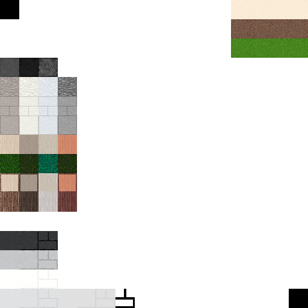

# r

### What?

The best voxel engine ever

### CLI:

```
pip install -r requirements.txt
python r.py [map]
```

`map` is a file in `maps` (with or without `.json`); default is `1`.

### Keybinds:

| Key | Use |
| --- | --- |
| W / A / S / D | Move forward / left / backward / right |
| Mouse move | Look around |
| Right mouse button | Hold to increase movement speed |
| Space | Fly up in debug mode; jump in normal mode |
| Left Shift | Fly down in debug mode |
| Backspace | Reset position |
| F11 | Toggle fullscreen |
| Backslash (`\`) | Cycle post-processing shader |
| Backquote (`` ` ``) | Save screenshot |
| Right Ctrl | Toggle wireframe debug mode |
| Right Shift | Exit |

### Settings:

There are two places, depending on whether a setting belongs to *you* or to *a map*:

- **`.env.pre`** has everything that is the same for every map (window size, fullscreen, fps cap, view distance, mouse sensitivity, mipmaps, texture atlas, shader files, audio, ...) with a comment on each line. It is always read, so the game runs with nothing else. To change something for yourself, make a file called `.env` (not tracked by git) with just the lines you want different, for example `WIDTH=1600` and `MUSIC_VOLUME=0.1`; any line in `.env` replaces the same line in `.env.pre`, and everything you leave out stays as in `.env.pre`. You never have to copy `.env.pre`.
- **The map file** (`maps/<map>.json`) has everything that belongs to that map: `config` (seed, spawn, background, physics, speed, optional `music`), `lights`, `lighting` and `world` (the blocks). `config.py` lists every key and what it does.

If a setting is missing or has a typo, the game says which one and exits.

**Window and fullscreen:** `WIDTH` and `HEIGHT` are the size of the window when it isn't fullscreen (kept between 1280x720 and 3840x2160, and never bigger than your screen). Fullscreen ignores them: it is a borderless window as big as your screen, at your screen's own resolution, so the monitor never switches video mode (no black flicker). F11 switches at any time. Any resolution and aspect ratio works (the field of view is vertical, so a wider screen just shows more to the sides), and on Windows the game tells the system to use real pixels, so it isn't stretched blurry on a screen with display scaling above 100%.

**Physics and frames:** the physics (movement, gravity, jumping, collisions) runs at `TICK_RATE` updates per second (64) no matter how many frames per second are drawn, so the game plays the same on a slow and a fast computer; the frames in between are drawn smoothly blended between two physics steps, and turning with the mouse happens every frame.

**Chunks and view distance:** the blocks are drawn in chunks of 16x16x16. Every frame only the chunks inside the camera's view, and no further away than `FAR_CLIP` (a sphere around the camera, 4096 by default so you only notice it if you lower it), are sent to the graphics card.

### Maps:

```json
{
    "name": "my map",
    "description": "...",
    "config": { "seed": 1, "start_pos": [0, 2, 0], "background_color": [0, 0, 0], "fly": false, "gravity": 24, "jump_speed": 6, "speed": 8, "sprint_multiplier": 4, "player_width": 0.5, "player_height": 1.5, "music": "1.mp3" },
    "lights": [ ... ],
    "lighting": { ... },
    "world": { ... }
}
```

- `music` is optional, it is a file in the `MUSIC_DIR` folder from `.env.pre`; a map without it is silent.
- **`lights`** is a list of as many lights as you like (none, a few, thousands), each with its own settings (only `radius` is needed, and `pos` unless it follows the player):

```json
{"pos": [10, 4, 0], "radius": 14, "intensity": 1.5, "color": [1.0, 0.2, 0.2], "falloff": "inverse_square", "falloff_scale": 0.3, "snap": true, "diffuse": 1.0}
{"follow_player": true, "pos": [0, 1, 0], "radius": 16, "color": [0.5, 0.875, 1.0]}
```

  `follow_player` makes `pos` an offset from the player, `snap` puts the light in the middle of its block, `diffuse` is how much the angle of a surface matters (0 to 1), `falloff` is `"linear"` or `"inverse_square"`. There are no shadows (light goes through walls), and a light inside a block doesn't light that block's own sides. `python r.py lights` is a map with five different lights to look at and fly around.

  A map can have any number of lights, but the graphics card can only light with a few at a time (`MAX_LIGHTS` in `.env.pre`, 32 by default, and fewer on a card that can't take that many). So every frame the game picks the lights that can light something you can see (a light behind you still counts if it reaches things in front of you, and lights further away than `FAR_CLIP` don't); if more than `MAX_LIGHTS` of them matter, the brightest, biggest and closest win, and the game tells you once that lights are being left out. Lights that follow the player are always used. A light that can't be seen costs the graphics card nothing; the only cost is a little time per frame to look through all the lights (about 0.4 ms for 10,000 lights, 4 ms for 100,000), so a map with thousands of lights runs about as fast as one with a few.
- **`lighting`** is everything that isn't one light, all optional: `ambient`, `ambient_color`, `brightness`, `per_block` (light whole blocks or single pixels) and `face_shade` (how bright each side of a block is: `top`, `bottom`, `front`, `back`, `left`, `right`).
- **`world`** has `voxels`, `cubes`, `spheres`, `cylinders`, `cones`, `trees` and `forests`; block names are in `world.py`.
  - A cube is either its edges (`x_min` ... `z_max`) or its middle and size (`x`, `y`, `z`, `size`; `size` can be one number or `[x, y, z]`).
  - Spheres, cylinders and cones can have a `scale` to stretch them along x / y / z: `"scale": [2, 1, 1]` is twice as wide in x (a sphere becomes an ellipsoid, a cylinder an elliptical one).

### Customization:

- Create your own map in `maps` ... run it with `python r.py <map>`
- Edit the textures in `resources/atlas.png`
- A new block needs a spot in `world.py` (`BLOCK_TYPES`) that points at its tile(s) in the atlas
- **Transparent blocks** need nothing but the picture: draw the tile in `atlas.png` with an alpha channel and the block is see-through, per block, automatically (`atlas.py` looks at every tile):
  - a tile whose pixels are either fully solid or fully gone (leaves, fences, ...) is a *cutout*: drawn like any other block with the gone pixels cut out
  - a tile with partly see-through pixels (glass, water, ...) is *translucent*: blended with what is behind it; a face between two blocks of the same translucent type is not drawn, and a solid block next to glass keeps its face
  - the tile row 0 is the bottom row of the png (the atlas is uploaded upside down)

### Files:

| File | What |
| --- | --- |
| `r.py` | Entry point: window, main loop, post-processing, fullscreen |
| `config.py` | Loads `.env.pre` / `.env` and a map file, and checks all of it |
| `world.py` | Blocks, shapes / trees, and the block mesh (solid and translucent) |
| `atlas.py` | Works out which tiles of the texture atlas are see-through |
| `camera.py` | Mouse look, physics ticks, collisions |
| `ticks.py` | Runs the physics at a fixed rate whatever the frame rate is |
| `chunks.py` | The 16x16x16 chunks and which of them can be seen |
| `matrices.py` | Model / view / projection matrices, and the 6 planes of the camera's view |
| `buffers.py` | OpenGL vertex buffers and the frame buffer |
| `glsl.py` | Shader loading and compiling |
| `lights.py` | Picks the lights that matter every frame (a map can have any number) |
| `uniforms.py` | Shader uniform values (matrices, lights, ...) |
| `log.py` | Console logging |
| `.env.pre` | Default settings for every map |
| `maps/` | Map files (their settings, lights and blocks) |
| `shaders/` | GLSL shaders (`block.*` for the world, `post_*.frag` for post-processing) |
| `resources/` | Texture atlas, window icon, music |
| `CHANGELOG.md` | Version history |

### Atlas:



### To-Do:
- Advanced tree functions (including the `WINDSWEPT` tree, which is a placeholder in `world.py`)
- Rend (the in-game worldedit): a chat in JetBrains Mono, opened with T, closed with Esc, sent with Enter; it only takes commands and says so when a command doesn't exist
- Place and destroy blocks (first on a hotkey at a position, eventually at the end of a directed ray)
