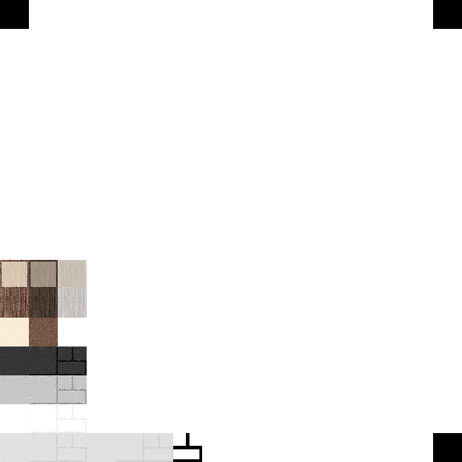

# r

### What?

The best voxel engine ever

### CLI:

```
pip install -r req.txt
python r.py [map]
```

`map` is a file in `DIR-Maps` (with or without `.json`); default is `1`.

### Keybinds:

| Key | Use |
| --- | --- |
| W / A / S / D | Move forward / left / backward / right |
| Mouse move | Look around |
| Right mouse button | Hold to increase movement speed |
| Space | Fly up in debug mode; jump in normal mode |
| Left Shift | Fly down in debug mode |
| Backspace | Reset position |
| Backslash (`\`) | Cycle post-processing shader |
| Backquote (`` ` ``) | Save screenshot |
| Right Ctrl | Toggle wireframe debug mode |
| Right Shift | Exit |

### Customization:

- Create your own map in `DIR-Maps` ... run it with `python r.py <map>`
- All settings (resolution, speed, light, paths, music, etc.) live in the `CONFIG` block of the map file, so every map can have its own; `cfg.py` lists every key and what it does
- Edit the textures in `DIR-Resources/IMG-Texture.png`

### Atlas:



### To-Do:
- Advanced tree functions
- Advanced shape functions for stretch
- CLI:
    - W/E
    - Other (etc.)
- On hotkey, place at pos ... eventually make it place at end of directed ray